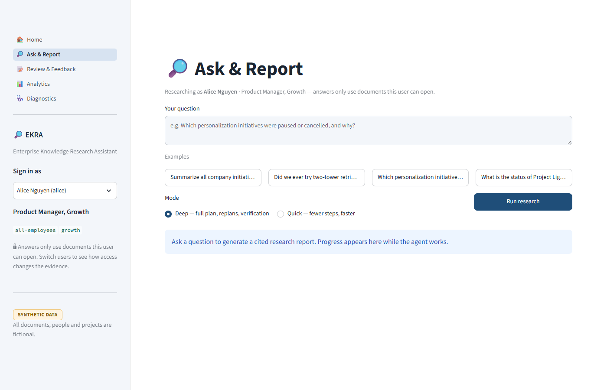
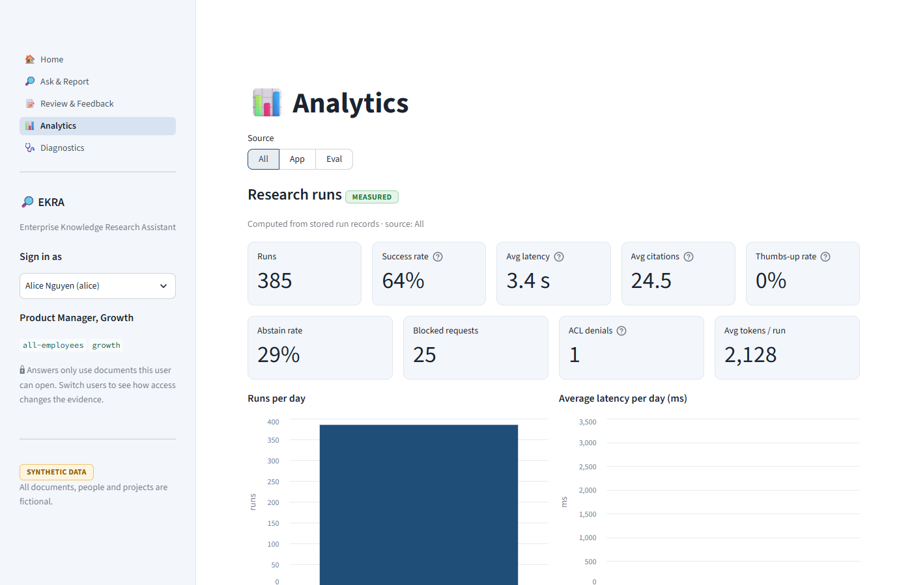
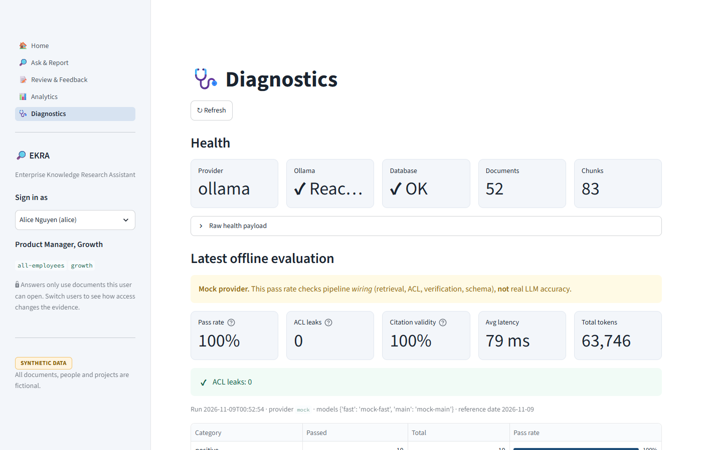
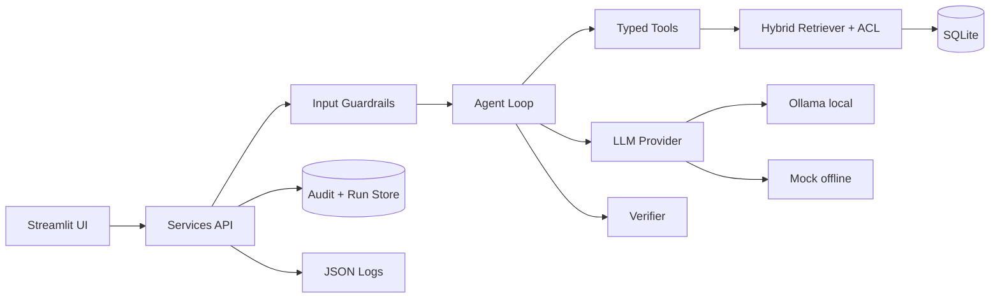

# EKRA: Agentic AI Research Assistant

An enterprise research assistant that answers complex questions from internal knowledge (wikis, PRDs, roadmaps, status reports, meeting notes). It **plans its own research steps, retrieves only what the asker may see, and returns a structured report where every claim cites a source.**

> **All data in this repository is synthetic.** Every document, person, team, project, number and date is invented (52 documents, 15 initiatives). Nothing here is real company data.

Example question: *"Summarize all company initiatives related to personalization and recommendation systems from the last 2 years."*
The assistant resolves the time window, finds the 9 matching initiatives the user may see, reads their documents (re-planning when it spots a gap), derives each initiative's status history, flags conflicting sources, and verifies every claim before showing the report.

| Ask & Report | Analytics | Diagnostics |
|---|---|---|
|  |  |  |

## Quick start (Windows, PowerShell)

```powershell
python -m venv .venv
.venv\Scripts\python -m pip install -r requirements.txt
.venv\Scripts\python -m app.data.seed --reset          # builds data/ekra.db from the synthetic corpus
.venv\Scripts\python -m streamlit run app/main.py --server.port 8503
```

Open http://localhost:8503 . Use any free port; the author's machine already had 8501 and 8502 in use.

**AI model:** the default provider is **Ollama running locally** (`llama3:8b` for planning and extraction, `gpt-oss:20b` for the summary, `nomic-embed-text` for embeddings). Pull them with `ollama pull <name>`.
No API key is needed and no data leaves the machine. OpenAI and other cloud providers are intentionally **not** supported.
To run fully offline without a model: `$env:LLM_PROVIDER="mock"` (deterministic; used by the tests).
Settings live in [config.yaml](config.yaml); overrides go in `.env` (see [.env.example](.env.example), never commit `.env`).

**Demo users** (the "Sign in as" picker): `alice` (PM, Growth team), `bob` (ML Platform engineer), `carol` (VP Strategy, sees confidential material), `dave` (external contractor, sees almost nothing). Switch users and ask the same question to see access change the answer.

## How it works



1. **Plan:** the time window is resolved in code ("last 2 years" becomes 2024-11-09 to 2026-11-09, matched against each document's *effective* date, not its edit date). The model only proposes extra search queries; if it fails, rule-based queries are used.
2. **Act:** find matching initiatives, scan which accessible documents mention them, then run searches in parallel (keyword + vector, fused by reciprocal rank fusion). The permission filter is applied **before** ranking.
3. **Observe and replan:** check that each initiative's key documents were actually read; if not, fetch them (up to 3 replans).
4. **Synthesize:** per initiative, the model extracts cited claims. **Status (shipped, paused, cancelled, active) is derived by rules**, so it is auditable. Conflicts are detected when two sources disagree within 45 days.
5. **Verify:** each claim must be supported by the passage it cites; claims with invented numbers or no support are dropped; document access is re-checked live before delivery.

Details: [docs/architecture.md](docs/architecture.md) (as built) and [docs/design.md](docs/design.md) (production-scale design deep dive, v2.0).

**Design deep dive (v2.0, 2026-11-12).** The design follows a 6-step framework (Requirements, Main System Components, Trade-offs, Failure Modes, Observability and Feedback Loops, Productionization and Operations). It designs each target behaviour explicitly: autonomous planning, relevant retrieval, synthesis, and a structured, cited response. A conformance table (section 0.2) maps each behaviour to its design, the prototype evidence and what is still open. Every claim tagged **[built]** in the design was checked against the code.

## Safety, governance and observability

| Area | What is implemented |
|---|---|
| Permissions | Group-based ACLs per document; pre-filter on every search; live re-check before delivery; deny by default when the ACL is missing or stale; hidden initiatives are invisible even in entity lookup |
| Prompt injection | User questions screened for override attempts; instruction-like sentences in documents are removed before prompting and reported as a security note |
| Hallucination control | Schema-validated model output (retry once, then rules-based fallback); claim-to-passage grounding check; invented numbers are dropped; "no accessible sources" is a valid answer |
| Budgets | 12 steps, 3 replans, 3 minutes, 60k tokens, 60 tool calls per run; repeated identical tool calls are suppressed; a capped run returns a partial answer |
| Audit trail | Who asked, which documents were retrieved and cited, model, config snapshot id, timestamp; access refusals and feedback are recorded |
| Config registry | Every run stores a snapshot id (config + prompt version) |
| Logs | Structured JSON (`logs/app.jsonl`) with request ids, durations, status, tokens; emails, phone numbers, SSNs, cards and API-key patterns are masked |
| Human review | Every report has a feedback step (rating, reason, comment) recorded in the audit trail. The assistant is read-only and takes no actions |

## Tests and evaluation

```powershell
.venv\Scripts\python -m pytest -q                                   # offline, uses the mock provider
.venv\Scripts\python -m evals.run --provider mock                   # 30-question golden set, wiring check
.venv\Scripts\python -m evals.run --provider ollama                 # same set on the real local models (slow)
```

The golden set ([evals/golden.jsonl](evals/golden.jsonl)) has 30 questions: 10 positive, 6 negative, 10 edge (time-window trap, prompt injection, stale ACL, superseded draft, keyword near-misses, over-long input, alias lookup, status conflict) and 4 permission tests. Every answer is also checked for global invariants: no uncited claim, no dangling citation, and **no document outside the asker's allow-list retrieved or cited**.

### Results (measured on 2026-11-09; full output in `evals/results/`)

| Run | Passed | Permission leaks | Citation validity | Avg time per question | Tokens |
|---|---|---|---|---|---|
| **Real local models** (`llama3:8b` + `gpt-oss:20b`) | **30 / 30** | **0** | 100% (467 citations checked) | 38 s (enumeration questions about 103 s, single-initiative about 32 s, "no sources" answers under 4 s) | 82,840 |
| Mock provider (offline wiring check) | 30 / 30 | 0 | 100% (521 citations checked) | under 0.1 s | 63,746 |
| pytest | **65 passed**, 0 failed | n/a | n/a | about 2 s | n/a |

Read these numbers with care:

- **The golden set was also used to find and fix bugs.** An earlier real-model run passed 8 of 9 sampled questions; the failure exposed three genuine defects (a status wrongly credited to a second initiative named in the same sentence, document coverage judged per document instead of per passage, and claim extraction ignoring the user's question). They were fixed and the full set re-run. A 100% score on a set used for development is **not** evidence of the same accuracy on new questions or real documents.
- **The mock result checks wiring only.** The mock's heuristics were written alongside the golden set. It shows retrieval, permissions, verification and schemas work, not that a language model is accurate.
- **One real-model run used a fallback.** On P02 the model-written summary failed the number check (it contained a figure not in the findings), so the safe template summary was shown instead. The run still passed; the fallback is logged in the run's `degraded` list.
- Latency is for one local machine with a 20B-parameter model and varies with load.
- Results use a fixed reference date (2026-11-09) so "last 2 years" is repeatable.


## Project layout

```
app/main.py, app/views/, app/ui/   Streamlit UI (built in a separate session)
app/services/                       the contract the UI calls (research, feedback, analytics, diagnostics)
app/agent/                          loop, planner, synthesizer, verifier, budget, prompts, rules
app/tools/                          typed read-only tools
app/retrieval/                      hybrid index, ACL
app/llm/                            ollama + mock providers
app/guardrails/                     input checks, injection handling, PII masking
app/core/                           config, Pydantic models, SQLite schema, JSON logging
app/data/                           synthetic corpus + seeding
evals/                              golden set, runner, saved results
tests/                              pytest suite
docs/                               design, architecture, scope, risks, data register (.md + .docx), presentation.pptx
scripts/                            diagram rendering, docx and pptx generators
```

## Assumptions and limitations

- **Synthetic data only.** Results on real documents will differ; run a pilot before drawing conclusions.
- Entity tags and aliases are **hand-seeded** (a stand-in for an extraction pipeline). Initiatives missing from the entity table cannot be summarized; the report says how many matching documents were set aside.
- **Status rules** are tuned to the phrases in the synthetic corpus; real documents need broader patterns or a trained classifier with human review.
- **Mock results check wiring, not AI quality.** The mock's heuristics were written alongside the golden set, so a high mock pass rate says the plumbing works, not that a language model is accurate.
- Local-model latency: roughly 1 to 3 minutes for an enumeration question on the author's machine; single-initiative questions take under a minute.
- SQLite plus an in-process index suits tens of documents, not millions. No SSO, real connectors, async jobs or long-term memory.
- **Built for two question types.** The agent's plans are built and tested for list-all (enumeration) and single-initiative lookup questions. Timeline, comparison and "why was it stopped" playbooks are designed (design.md 2.3.6) but not built; reasons are not yet extracted as a separate field.
- **No clarifying question or plan preview yet.** Ambiguous questions are answered with stated assumptions.
- **The golden set doubled as a debugging set.** A held-out question set is needed before claiming accuracy on new questions.
- Time-window phrases supported: last N units, last/this year, since/in a year, quarters, half-years, "between X and Y".

## Documents

| Document | Purpose |
|---|---|
| [docs/design.md](docs/design.md) / [.docx](docs/design.docx) | Production-scale design deep dive (v2.0): behaviour conformance check, requirements, components (autonomy boundary, intent playbooks, relevance and sufficiency rules), 18 trade-offs, 20-item failure mode analysis, observability, feedback loops, SLOs, runbooks, cost, rollout |
| [docs/architecture.md](docs/architecture.md) / [.docx](docs/architecture.docx) | As-built architecture with diagrams |
| [docs/scope.md](docs/scope.md) / [.docx](docs/scope.docx) | Scope, requirements, acceptance criteria |
| [docs/estimates_risks.md](docs/estimates_risks.md) / [.docx](docs/estimates_risks.docx) | Estimates and risk register |
| [docs/data_sources.md](docs/data_sources.md) / [.docx](docs/data_sources.docx) | Data-sources register (synthetic vs measured) |
| [docs/presentation.pptx](docs/presentation.pptx) | Six-slide overview in plain English |
