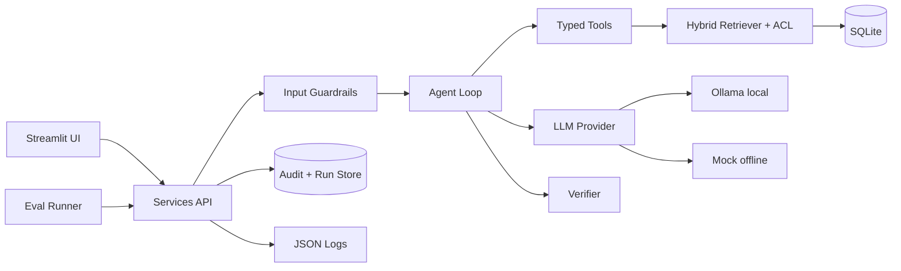
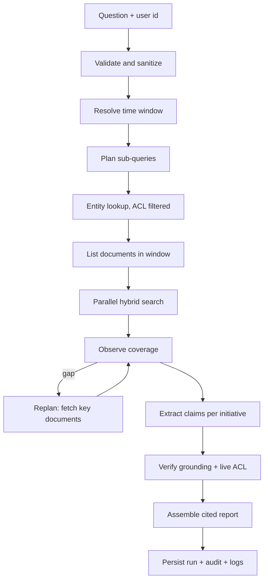
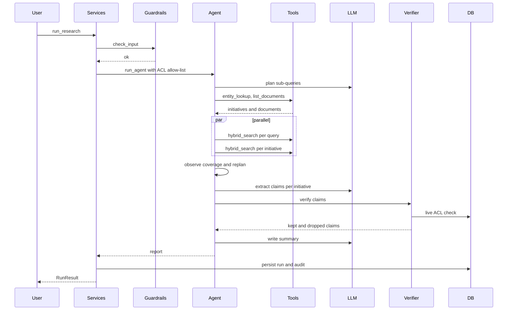
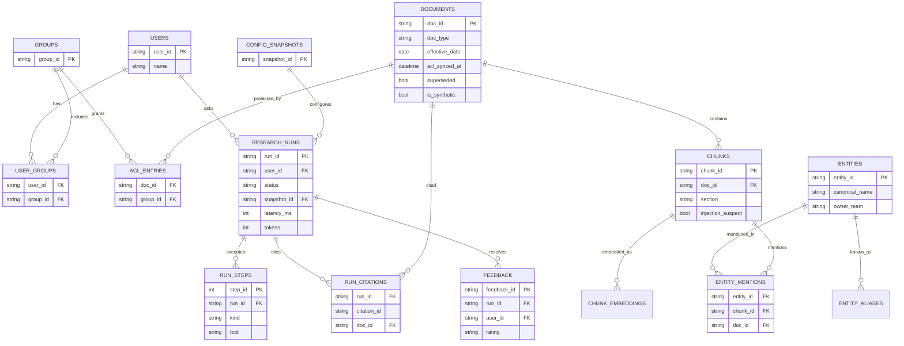

# EKRA: As-Built Architecture (prototype)

This document describes what was **actually built**. The production-scale target design is in [design.md](design.md). Every document, person, team, project and number in the prototype corpus is **synthetic**.

## 1. Architecture

| Component | File | Responsibility |
|---|---|---|
| UI (separate session) | `app/main.py`, `app/pages/`, `app/ui/` | Ask, report, review, analytics, diagnostics pages |
| Services (the contract) | `app/services/*.py` | Only API the UI calls; Pydantic shapes in `app/core/models.py` |
| Input guardrails | `app/guardrails/input.py`, `pii.py` | Length/type checks, injection patterns, PII masking |
| Agent loop | `app/agent/loop.py` | Plan, act, observe, replan, synthesize, verify |
| Planner | `app/agent/planner.py`, `timewin.py` | Time window in code; LLM only proposes sub-queries |
| Budget | `app/agent/budget.py` | Step, time, token and tool-call caps; loop detection |
| Tools | `app/tools/` | `entity_lookup`, `list_documents`, `hybrid_search`, `fetch_document` with validated schemas |
| Retriever | `app/retrieval/index.py`, `acl.py` | BM25 + vectors with RRF; ACL applied before ranking |
| Synthesizer | `app/agent/synthesizer.py` | Per-initiative claim extraction, summary, conflicts |
| Verifier | `app/agent/verifier.py` | Claim-to-passage grounding; live ACL re-check |
| LLM providers | `app/llm/` | `ollama` (default, local), `mock` (offline). OpenAI is deliberately not supported |
| Store | `app/core/db.py` | SQLite, foreign keys on, CHECK constraints |

## 2. Data flow (one question)

## 3. Request sequence

## 4. Data model

Additional tables not drawn: `audit_log` (who, what, when, model, request id), `chunk_embeddings` (cache), `entity_aliases`.

## 5. Key design decisions (with business why)

| Decision | Why it matters to the business |
|---|---|
| ACL filter applied **before** ranking, then re-checked live before delivery | Leaders can trust that restricted material never appears in a summary |
| Initiative **status derived by rules**, not by the model | Status changes are auditable; a model cannot invent "shipped" |
| Time windows resolved **in code** against each document's *effective* date | "Last 2 years" means the same thing every time, even if a 2023 doc was edited in 2025 |
| Every claim verified against its cited passage; invented numbers are dropped | Fewer wrong statements reach decision-makers |
| LLM output validated (JSON schema, retry once, rules-based fallback) | The assistant keeps working if the local model misbehaves |
| Local Ollama by default; OpenAI not supported | Company data stays on the machine; no per-query cost |
| One planner agent with parallel fan-out, not many agents | Simpler traces and fewer cascading errors |

## 6. Limitations of the prototype

- Entity tags and aliases are **seeded by hand** (a stand-in for an extraction pipeline). Initiatives that are not in the entity table cannot be summarized; the report says how many matching documents belong to initiatives outside the topic.
- Status rules cover the phrases in the synthetic corpus; real documents need broader patterns or a trained classifier.
- SQLite plus in-process vectors suit ~50 documents, not millions.
- Demo identities replace SSO. There is no real connector, no async job queue and no long-term memory.
