# EKRA Agentic Research Assistant: System Design Deep Dive

**Mode:** design only (no new code). **Author:** Hema Chepuri. **Version:** 2.0, 2026-11-12 (replaces v1.0 of 2026-11-08).
**Running example:** *"Summarize all company initiatives related to personalization and recommendation systems from the last 2 years."* As of 2026-11-12 this resolves to the window **2024-11-12 → 2026-11-12**.
**Evidence base:** design choices marked **[built]** are implemented and measured in the EKRA prototype in this repo (52 synthetic documents, 30/30 golden questions on local models, 0 permission leaks, 65 tests). Everything else is the production-scale design. **All numbers marked *illustrative* are planning assumptions, not measurements.**

---

## 0. How to read this document

### 0.1 Target system behaviour

The design exists to deliver four behaviours. Each one is designed explicitly in Section 2 and traced through every later step.

| # | The system should... | Designed in | Main failure modes | Measured by |
|---|---|---|---|---|
| B1 | Autonomously plan research steps | 2.3 Planning and agent loop (2.3.5 autonomy boundary, 2.3.6 intent playbooks) | F1 loops, F2 derailment, F6 cost runaway | Steps per run, replan rate, budget-hit rate, coverage score |
| B2 | Retrieve relevant internal information | 2.4 Ingestion, 2.5 Retrieval (2.5.1 relevance and sufficiency), 2.6 Tools | F7 permission leak, F10 low recall, F12 time misattribution | Recall at k, enumeration recall, ACL-leak rate (= 0), tool error rate |
| B3 | Synthesize findings | 2.7 Synthesis and memory | F3 context overflow, F11 entity confusion, F4 cascading errors | Faithfulness, duplicate-entity rate, conflict detection rate |
| B4 | Generate a structured response with references to source documents | 2.8 Response contract and verification | F5 hallucination, F17 dangling citation | Citation validity, uncited-claim rate (= 0), schema pass rate |

### 0.2 Behaviour conformance check

How each behaviour is satisfied, what proves it, and what is still open.

| Behaviour | Satisfied by | Evidence today | Still open (production) |
|---|---|---|---|
| B1 Plan autonomously | Plan schema (2.3.2), state machine with coverage-driven replanning (2.3.3), autonomy boundary (2.3.5), intent playbooks (2.3.6), budgets (2.3.4) | Prototype plans, fans out, checks coverage per passage and replans up to 3× within budgets; 30/30 golden **[built]** | Clarifying question and plan preview; playbooks beyond enumeration and lookup |
| B2 Retrieve relevant internal info | Ingestion (2.4), hybrid pre-filtered retrieval (2.5), relevance gates and sufficiency (2.5.1), typed tools (2.6) | Hybrid BM25 + vector + RRF with ACL and date pre-filter; alias, near-miss and time-trap items pass; 0 leaks **[built]** | Real connectors, cross-encoder rerank, automatic entity extraction |
| B3 Synthesize findings | Map-reduce with rule-derived status, conflicts, timeline, gaps (2.7.1); memory (2.7.2) | Per-initiative extraction, status by rules, 45-day conflicts **[built]** | Hierarchical reduce at scale; reason extraction; entity merge review |
| B4 Structured response with references | Response contract (2.8.1), verifier (2.8.2) | 100% citation validity over 467 real-model citations; template-summary fallback used once **[built]** | NLI grounding; export with deep links |

### 0.3 Deliverables map

The five required deliverables are assembled from the six framework steps as follows.

| Deliverable | Framework steps it contains | Sections |
|---|---|---|
| 1. Architecture diagram | Step 2 (Main System Components) | 2.1 context and logical architecture, 2.10 deployment topology; supporting diagrams in 2.3 (agent state machine), 2.4 (ingestion), 2.5 (retrieval), 2.9 (sequence), 2.11 (data flow, data model) |
| 2. Written system design document | Steps 1 and 2 | 0.2 conformance check, 1 Requirements, 2 Main System Components (incl. 2.3.5 autonomy boundary, 2.3.6 intent playbooks, 2.5.1 relevance and sufficiency) |
| 3. Trade-off analysis | Step 3 | 3.1 method, 3.2 ledger by step, 3.3 decision deep dives, 3.4 prototype vs production deltas |
| 4. Failure mode analysis | Step 4 | 4.1 method, 4.2 FMEA by pipeline stage, 4.3 agentic six, 4.4 fail-open vs fail-closed policy, 4.5 degradation ladder, 4.6 human-in-the-loop |
| 5. Production operations discussion | Steps 5 and 6 | 5 Observability and Feedback Loops, 6 Productionization and Operations |

### 0.4 Executive summary

- **What it is:** a read-only research agent over internal knowledge (wikis, PRDs, roadmaps, Jira, status reports, meeting notes). It plans its own research, retrieves only what the asker may open, synthesizes across documents and returns a structured report where every claim cites a source.
- **Why an agent and not plain RAG:** top-k retrieval answers "what is X". It fails at "summarize **all** X over **2 years**", which needs decomposition, recall beyond top-k, cross-document deduplication, time ordering and conflict handling.
- **Core design bets:** (1) a **single planner with bounded replanning** and deterministic parallel workers, not a multi-agent swarm; (2) **hybrid retrieval with ACL pre-filtering** plus an entity store for enumeration; (3) **map-reduce synthesis** with rule-derived status and conflict detection; (4) a **verifier** that drops any claim it cannot ground and re-checks access live before delivery.
- **Business why:** leaders and PMs make planning decisions from these reports. One leaked document is a security incident; one confident wrong claim costs more trust than a slower, terser answer. The design therefore ships **trust features first** and buys speed and breadth afterwards.

---

## 1. Requirements

### 1.1 Problem statement and users

Knowledge about initiatives is scattered across six or more systems, written under different code names, and goes stale quickly. A PM preparing a planning review spends hours finding what has been tried, by whom, and what happened. Duplicate initiatives get funded because nobody could find the earlier one.

| Persona | Typical question | What they need most | Risk if wrong |
|---|---|---|---|
| Product manager | "What personalization work happened in the last 2 years?" | Complete list (recall), timeline, owners | Duplicate investment |
| Engineer | "Did we ever try two-tower retrieval for the home feed?" | Fast, precise prior art with the owning team | Re-solving a solved problem |
| Leader / strategy | "Which of those were shut down and why?" | Status, reasons, conflicts surfaced | Decision on stale facts |
| New hire | "What is Project Compass?" | Plain summary, links to read | Low; mostly onboarding |
| External contractor | Any | Must see only what they are entitled to | Security incident |

### 1.2 Clarifying questions (with the answers assumed)

| Question | Assumed answer | Design consequence |
|---|---|---|
| Who are the users and how do they sign in? | About 20k employees and some contractors, all through SSO (OIDC/SAML) | Identity on every request; group expansion for ACLs |
| Which sources? | Confluence/wiki, SharePoint/Drive, Jira, meeting transcripts and notes, status reports, PRDs, roadmap decks | Connector per system; format-aware parsing |
| Do sources expose permissions and change events? | Most do (webhooks or change feeds); some only nightly exports | Event-driven sync plus nightly reconciliation; deny by default when stale |
| What decisions does it support? | Planning, prior-art search, leadership briefings | Read-only; informs, never acts |
| Does it write anywhere? | No in v0 and v1 | All tools read-only; write tools only with human approval (v2) |
| Compliance? | Document-level permissions; HR, legal and PII restricted; data residency; audit | Pre-filter ACL, restricted collections opt-in, audit trail, regional LLM endpoints |
| Latency expectations? | Quick lookups in seconds; landscape reports can take minutes | Two modes: quick (sync, streamed) and deep (async job) |
| Which LLMs are allowed? | Enterprise contracts with zero data retention, or self-hosted models | LLM gateway with provider abstraction **[built: local Ollama, no cloud]** |
| What does "last 2 years" mean? | Rolling 24 months from today unless the user says calendar or fiscal | Deterministic date resolver; clarifying question if ambiguous |
| Budget? | Roughly $25k/month LLM spend at full adoption (illustrative) | Model routing, caching, per-run caps |

### 1.3 Functional requirements (traced to behaviours)

| ID | Requirement | Behaviour | Acceptance criterion |
|---|---|---|---|
| FR1 | Accept natural-language questions: lookup, multi-hop, comparison, timeline, enumeration ("all X") | B1 | Intent classified correctly on ≥ 95% of golden set |
| FR2 | Resolve relative time ("last 2 years", "H1 2025", "since Q3") to absolute windows | B1 | 100% of supported phrases resolved in code, not by the model **[built]** |
| FR3 | Produce a research plan (sub-queries, tools, stop criteria) and show it to the user before deep runs | B1 | Plan preview shown for every deep run |
| FR4 | Execute the plan with tools, observe results and replan when gaps are found | B1 | Coverage check runs after every act step; replans capped at 3 **[built]** |
| FR5 | Ask one clarifying question when the request is ambiguous | B1 | Ambiguous golden items trigger a question, not a guess |
| FR6 | Retrieve across all connected sources, limited to what the user may open | B2 | ACL-leak rate = 0 on permission tests **[built: 0 leaks]** |
| FR7 | Find content written under aliases and code names | B2 | Alias golden items pass **[built]** |
| FR8 | Filter by the date the content refers to (effective date), not the edit date | B2 | Time-window trap items pass **[built]** |
| FR9 | Deduplicate findings by initiative across documents and sources | B3 | Duplicate-entity rate ≤ 2% |
| FR10 | Derive each initiative's status and timeline; flag conflicting sources | B3 | Status matches golden label; conflicts within 45 days flagged **[built]** |
| FR11 | Return a structured report: summary, findings, timeline, conflicts, gaps, citations | B4 | 100% schema-valid output **[built]** |
| FR12 | Every claim cites at least one openable passage (doc, section, date) | B4 | Uncited-claim rate = 0; citation validity ≥ 98% **[built: 100%]** |
| FR13 | Say "not found" or "no accessible sources" instead of guessing | B4 | Negative golden items abstain **[built]** |
| FR14 | Feedback on the whole answer and on single claims | All | Feedback stored with run ID in the audit trail **[built]** |
| FR15 | Follow-ups within a session ("only the paused ones") | B1, B3 | Session context reused without re-retrieving unchanged evidence |
| FR16 | Export the report (Markdown, docx, PDF) with live links | B4 | Export keeps citations clickable |

### 1.4 Non-functional requirements (illustrative)

| Dimension | Target | Why this number |
|---|---|---|
| Users | 20k employees; 2k daily active | Typical mid-to-large enterprise |
| Load | About 6k queries/day; 85% quick, 15% deep; peak about 1 QPS, up to about 30 concurrent deep runs | See 1.5 |
| Corpus | About 5M documents, 60M chunks, 50k changed docs/day | Six sources, several years of history |
| Latency, quick mode | First token < 3 s; p95 total < 20 s | Feels like search |
| Latency, deep mode | Plan preview < 5 s; p95 report < 4 min, with progress events | Users accept minutes for a report that saves hours |
| Freshness | Content indexed < 15 min after change; ACL change applied < 5 min | Status reports change weekly; revoked access must stop quickly |
| Availability | 99.5% answer path; degrade to cited search results if LLMs fail | Internal tool, business hours critical |
| Quality | Faithfulness ≥ 95%; citation validity ≥ 98%; enumeration recall ≥ 85%; ACL-leak rate = 0 | Trust bar for leadership use |
| Cost | ≤ $0.05 quick, ≤ $0.60 deep, blended ≈ $0.13 per query | Fits budget in 1.2 |
| Security | SSO; encryption at rest and in transit; zero-retention LLM contracts; full audit | Enterprise security review |
| Data residency | Index, logs and LLM calls stay in region | Compliance |

### 1.5 Capacity estimates (illustrative, back of the envelope)

| Quantity | Calculation | Result |
|---|---|---|
| Average load | 6k queries over an 8-hour business day | ≈ 0.2 QPS |
| Peak load | 5× average | ≈ 1 QPS |
| Concurrent deep runs at peak | 1 QPS × 15% deep × 180 s average | ≈ 27 runs |
| LLM calls per day | 5,100 quick × 4 + 900 deep × 45 | ≈ 61k calls |
| LLM tokens per day | 5,100 × 12k + 900 × 150k | ≈ 200M tokens |
| Vector storage | 60M chunks × 1024 dims × 1 byte (int8) | ≈ 60 GB (240 GB at float32) |
| Keyword index | About 30 GB of chunk text plus postings | ≈ 60–100 GB |
| Daily re-embedding | 50k docs × 12 chunks × 500 tokens | ≈ 300M embedding tokens/day (cheap) |
| Audit and trace storage | 6k runs × about 200 KB of trace (by reference) | ≈ 1.2 GB/day, 1-year retention ≈ 450 GB |

**Consequence:** the bottleneck is not storage or QPS. It is **LLM throughput and rate limits during deep runs**, then reranker latency, then ACL-filter selectivity for users in thousands of groups. Section 6.3 plans for these in that order.

### 1.6 Quality bars and business KPIs

- **What "done" means for one answer:** correct, grounded, permitted, cited, on time. Every claim links to a passage the user can open; nothing the user may not open was retrieved, quoted or summarized; missing information is stated as a gap.
- **Quality KPIs:** faithfulness, citation validity, enumeration recall, abstain correctness, ACL-leak rate.
- **Business KPIs:** research time saved per query (survey plus task timing), weekly active users, share of answers rated useful, reports exported into planning docs, duplicate initiatives caught in planning reviews.

### 1.7 Never list (hard rules)

1. NEVER retrieve, quote, summarize or cite a document the user cannot open.
2. NEVER state a claim that is not grounded in a retrieved passage. Say "not found" instead.
3. NEVER follow instructions found inside retrieved content.
4. NEVER take a write or side-effect action without explicit human approval.
5. NEVER let long-term memory or a cache override what the current source documents say.
6. NEVER invent a number, date or name that is not in the cited passage.

### 1.8 Top user journeys

| Journey | Actor | Trigger | Steps | Outcome |
|---|---|---|---|---|
| J1 Landscape report | PM | Planning review next week | Asks the running example → sees plan preview → deep run with progress → reviews report with 9 initiatives and timeline → flags one outdated claim → exports | Planning doc gets a cited landscape in minutes instead of hours |
| J2 Prior art | Engineer | Design review | "Did we try two-tower retrieval for the home feed?" → quick answer with 3 citations and the owning team | Avoids rebuilding; knows whom to ask |
| J3 Follow-up | Leader | Reading J1's report | "Which were shut down and why?" → session reuses evidence → answer cites post-mortems, shows a status conflict | Decision made on reconciled facts |
| J4 Access boundary | Contractor | Same question as J1 | Retrieval sees only permitted docs → "no accessible sources" or a smaller report, with no hint of hidden initiatives | No leak, no confusion |

### 1.9 Out of scope (v0 and v1)

Write actions in source systems; answering from the open web; personal email and chat; HR or legal collections unless explicitly opted in; numeric analytics over databases (that is a BI tool's job); fully automatic decisions.

### 1.10 Assumptions

- Source systems expose ACLs and change events; where they don't, nightly sync with stricter deny-by-default applies.
- Entity and effective-date extraction are probabilistic; low-confidence cases are flagged, not hidden.
- An enterprise LLM contract with zero retention exists, or local models are used (as in the prototype).
- All numbers marked illustrative must be validated in a pilot.

---

## 2. Main System Components

### 2.1 Architecture diagram (logical)

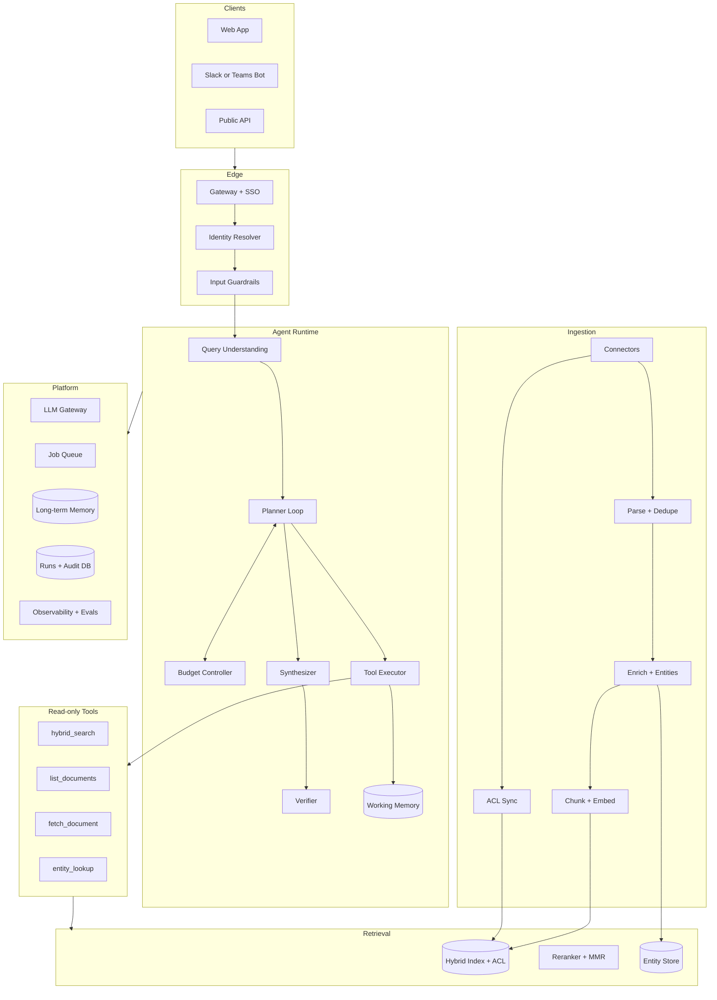

**Two planes.** The **online plane** (Edge → Agent Runtime → Tools → Retrieval) answers questions and is latency-sensitive. The **offline plane** (Ingestion) turns messy sources into citable, permission-tagged, time-aware evidence. They meet only at the index and entity store, so ingestion load never slows answers.

### 2.2 Component catalogue

| Component | Responsibility | Interfaces | Behaviour | Business why |
|---|---|---|---|---|
| Gateway + SSO | Authenticates, rate-limits per user, terminates TLS | OIDC/SAML in; request with user ID out | All | Every request carries identity; no anonymous access |
| Identity resolver | Expands user into ACL principals (user ID + groups), cached 5 min | Directory API (SCIM/Graph) | B2 | Makes pre-filtering possible; security sign-off is simple |
| Input guardrails | Length/type limits, injection heuristics + classifier, PII detection, restricted-topic policy | Question in; allow/deny + reasons out | All | Stops misuse before money is spent **[built]** |
| Query understanding | Intent, entities, time window, mode (quick/deep), ambiguity score | Question in; `Task` object out | B1 | Avoids answering the wrong question confidently |
| Planner loop | Upfront plan, then Plan → Act → Observe with bounded replanning | `Task` in; evidence ledger out | B1 | Autonomy that can be previewed and audited **[built]** |
| Budget controller | Caps steps, replans, tokens, dollars, wall-clock; detects repeated calls | Consulted before every step | B1 | Predictable cost and latency **[built]** |
| Tool executor | Runs typed read-only tools in parallel; validates args and outputs; timeouts, retries, circuit breakers | Tool call in; typed result or error observation out | B2 | Most agents break at the tool boundary **[built]** |
| Retrieval layer | Query rewrite → hybrid keyword + vector with ACL pre-filter → fuse → rerank → diversify → boost | Query + filters + principals in; ranked chunks out | B2 | Jargon needs keywords; paraphrases need vectors **[built: BM25 + vector + RRF]** |
| Entity store | Initiatives, teams, products with aliases and mentions | `entity_lookup`, mentions per chunk | B2, B3 | Enumeration and deduplication become reliable **[built: hand-seeded]** |
| Ingestion pipeline | Connectors, parsing, dedupe, enrichment, chunking, embeddings, ACL sync | Source events in; index rows out | B2 | Messy sources become citable evidence |
| Synthesizer | Map: extract structured records per passage. Reduce: resolve entities, derive status, order timeline, detect conflicts, write summary | Evidence ledger in; draft report out | B3 | "All X" answered with coverage, not top 5 chunks **[built]** |
| Verifier | Grounding check per claim, citation resolution, number check, live ACL re-check | Draft in; verified report + dropped claims out | B4 | No uncited or ungrounded claim ships **[built]** |
| LLM gateway | Model routing, prompt caching, quotas, failover, redaction, token metering | Prompt in; completion + usage out | All | Cost and availability under control; models are config |
| Working memory | Per-run plan, evidence ledger, scratchpad, budgeted to context | In-process / Redis | B1, B3 | Keeps the loop coherent without context overflow |
| Long-term memory | Opt-in preferences and saved reports; TTL, delete, ACL re-check | Postgres | B3 | Follow-ups and personalization without stale facts as evidence |
| Job queue | Deep runs as async jobs; progress events (SSE); cancel | Queue + workers | B1 | Long reports do not time out chat clients |
| Runs + audit DB | Who asked what, docs retrieved and cited, model, config snapshot, cost, feedback | Postgres | All | Governance and incident forensics **[built: SQLite]** |
| Observability + evals | Traces, metrics, logs, offline and online evals, dashboards | OpenTelemetry, eval runner | All | You cannot debug reasoning you did not trace **[built: JSON logs, diagnostics page]** |

### 2.3 Behaviour B1: autonomously plan research steps

#### 2.3.1 Query understanding

Runs before the planner and produces a typed `Task`. Deterministic code does what code does reliably; the model only does what needs language understanding.

| Sub-step | Done by | Output | Notes |
|---|---|---|---|
| Normalize and screen | Code + classifier | Clean text, guardrail verdict | Max length, injection patterns **[built]** |
| Intent | Small model, rules fallback | `lookup`, `enumeration`, `comparison`, `timeline`, `status` | Enumeration triggers deep mode |
| Time window | **Code only** | `{from, to, basis}` | "last 2 years", quarters, halves, "since", "between" **[built]**. The model never computes dates |
| Entities and topic | Entity store + small model | Seed entity IDs, topic synonyms | Aliases resolved here ("RecSys v2" = "Project Compass") |
| Scope | Code | Source types, business units | Defaults to all accessible sources |
| Mode | Rules | `quick` or `deep` | Enumeration, "all", "summarize ... over" → deep |
| Ambiguity | Rules + model score | Clarifying question or proceed | Ask once; otherwise state the assumption in the report |

#### 2.3.2 Plan representation

The plan is data, not prose, so it can be previewed, budgeted, logged and replayed.

```json
{ "task_id": "t_8f2", "goal": "Enumerate personalization and recsys initiatives, 2024-11-12 to 2026-11-12",
  "mode": "deep",
  "sub_queries": [
    {"id": "q1", "tool": "entity_lookup", "args": {"topic": "personalization"}},
    {"id": "q2", "tool": "hybrid_search", "args": {"query": "recommendation ranking roadmap", "doc_type": ["roadmap","prd"]}},
    {"id": "q3", "tool": "list_documents", "args": {"entity_ids": ["$q1.ids"], "effective_from": "2024-11-12"}}
  ],
  "coverage_targets": {"per_entity_doc_types": ["status_report","prd"], "per_quarter": true},
  "stop_criteria": {"all_entities_covered": true, "max_steps": 12, "max_replans": 3},
  "budget": {"tokens": 60000, "usd": 0.80, "seconds": 240} }
```

- **The model proposes extra sub-queries; code owns the skeleton.** If the model's plan fails schema validation twice, a rule-based plan (synonym list × doc types) is used **[built]**. This keeps autonomy without making planning a single point of failure.
- **Plan preview:** deep runs show the plan (topics, sources, window, estimated time) before spending money. The user can edit the scope.

#### 2.3.3 Agent loop state machine

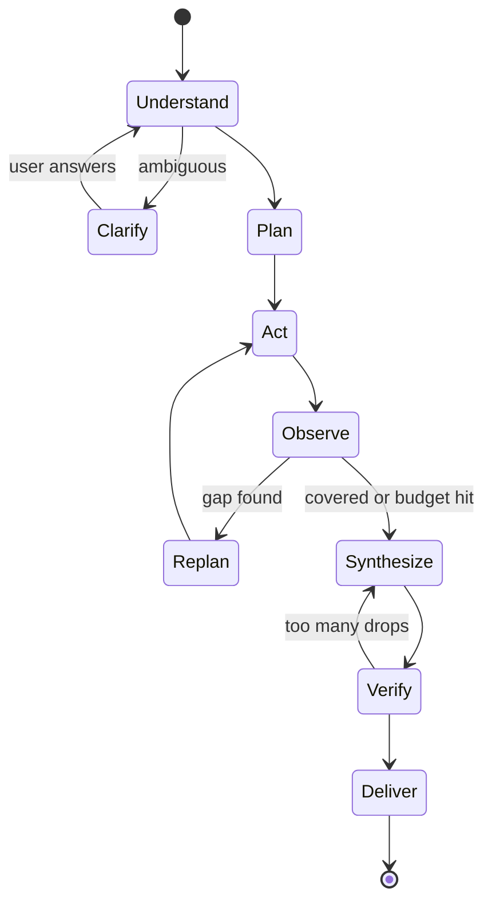

- **Act:** independent tool calls run in parallel; a fan-out counts as one step **[built]**.
- **Observe:** a **coverage check** in code: for each candidate entity, were its key document types read? For enumeration, is every quarter × source type touched? Per-passage, not per-document **[built after a real-model bug]**.
- **Replan triggers:** uncovered entity, empty quarter, a new alias discovered in evidence, a tool error with a usable hint. Each replan fetches at most 6 documents **[built]**.
- **Stop criteria:** coverage met, or any budget hit. Hitting a budget produces a **partial answer** that lists what was not covered; it never fails silently.
- **Goal anchoring:** every planner prompt restates the original goal and window; candidate steps are scored for relevance and off-topic steps are pruned.

#### 2.3.4 Budgets (per run)

| Budget | Quick | Deep | On breach |
|---|---|---|---|
| Steps | 4 | 12 **[built]** | Stop, synthesize what exists |
| Replans | 1 | 3 **[built]** | Stop replanning, note gaps |
| Tool calls | 15 | 60 **[built]** | Refuse new calls |
| Tokens | 15k | 60k **[built]** | Switch to extract-only, then stop |
| Dollars | $0.08 | $0.80 | Stop, partial answer |
| Wall clock | 20 s | 4 min (prototype 3 min **[built]**) | Stop, partial answer |
| Identical call repeats | 0 | 0 **[built]** | Suppressed, logged |

#### 2.3.5 Autonomy boundary: what the agent decides vs what code decides

"Autonomous" here means the agent chooses **what to look for, where, and when it has enough**, inside rails that code enforces. The split is deliberate: the model handles language judgement; code handles anything that must be exact, safe or auditable.

| Decision | Made by | Bounded by |
|---|---|---|
| Which topics, synonyms and sub-queries to search | **Agent** (model proposes; rules add a baseline set) | Query length; injection screen on each proposed query **[built]** |
| Which tools to call and in what order | **Agent** via the intent playbook (2.3.6), adapted per step | Tool allow-list; read-only tools |
| Which documents to read in full | **Agent** from coverage gaps | Max 6 fetches per replan **[built]** |
| Whether to replan or stop | **Agent** using the coverage check result | Replan cap 3; budgets |
| Whether a passage is relevant to the question | **Agent** in question-aware extraction **[built]** | Rerank threshold (2.5.1) |
| Which initiative a fact belongs to | Agent extracts; **code** attributes to the sentence's subject **[built]** | Entity store |
| Time window, permissions, status, conflicts, number checks | **Code only** | Never delegated to the model |
| Whether a claim ships | **Verifier (code + NLI)** | Never the model that wrote it |

#### 2.3.6 Intent playbooks: how the plan differs by question type

The running example is an enumeration question. Other intents get different plans, tools and answer shapes from the same components.

| Intent | Example | Mode | Plan skeleton | Stop when | Answer shape |
|---|---|---|---|---|---|
| Lookup | "What is Project Compass?" | Quick | `entity_lookup` → `hybrid_search` on the entity → fetch top doc | ≥ 2 independent supporting passages, or 1 authoritative (PRD/status report) | Summary + 3–5 cited facts + owner team |
| Prior art | "Did we ever try two-tower retrieval?" | Quick | `hybrid_search` with synonyms, no time filter → `entity_lookup` on hits | Top results agree, or none above relevance threshold → "not found" | Yes/no/unclear + cited examples + who to ask |
| Enumeration | Running example | Deep | `entity_lookup` + `list_documents` + `hybrid_search` fan-out → coverage check → replan | Every candidate entity has its key doc types read; every quarter touched | Full report (2.8.1) |
| Timeline | "How did the feed ranking project evolve?" | Deep | Entity → all dated docs in window, ordered → fetch milestone docs | Each quarter in window covered or marked as a gap | Timeline-first report |
| Comparison | "Compare Compass and Atlas" | Quick or deep | Run the lookup playbook per entity in parallel → align on fields (goal, status, owner, results) | Each entity has each field filled or marked unknown | Side-by-side table, cited per cell |
| Status / why | "Which were shut down and why?" | Quick (follow-up) | Reuse session evidence → targeted search for post-mortems, decision notes, status reports | Each paused or cancelled initiative has a reason passage or a stated gap | Findings with `reason` and conflicts |

#### 2.3.7 Single agent vs multi-agent

A **single planner** orchestrates **deterministic parallel workers** (search, fetch, extract). Specialist agents would add handoffs, each of which can lose context or compound an error, and would make traces harder to read. The work here is breadth (many similar retrievals and extractions), which parallel workers handle without separate reasoning agents. Revisit if new tool families (e.g. SQL over metrics) need very different reasoning. See trade-off T2.

### 2.4 Behaviour B2 (part 1): ingestion that makes retrieval possible

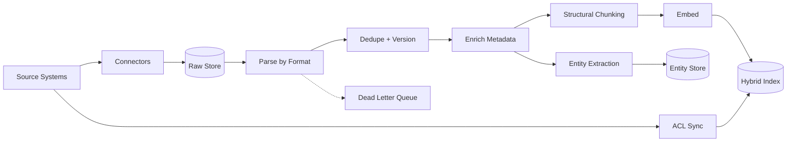

| Stage | Design | Failure handling |
|---|---|---|
| Connectors | Webhook or change feed per source, plus nightly full reconciliation; incremental cursors; per-source rate limits | Circuit breaker; backlog alert; reconciliation repairs missed events |
| Raw store | Immutable original bytes + source metadata, keyed by `(source, id, version)` | Enables reparse without refetch |
| Parse by format | Slides keep slide titles; transcripts split by speaker turn and agenda item; Jira keeps epic → story links; tables kept as tables; OCR only when needed | Parse failures go to a dead-letter queue with a reason; the doc is excluded, never half-indexed |
| Dedupe and version | Exact hash + MinHash near-duplicates; latest version wins; superseded drafts marked **[built: superseded flag]** | Keep lineage to cite the right version |
| Enrich | `doc_type`, owner, team, **effective date** (the date the content is about), status phrases, classification | Low-confidence effective date → flagged, falls back to created date with a penalty **[built: effective date]** |
| Entity extraction | NER + alias matching against the entity store; new candidate entities queued for review | Low-confidence merges flagged for a human (v1); hand-seeded in prototype **[built]** |
| Chunking | Follows structure: heading, section, slide, speaker turn; 300–800 tokens; heading path prepended; char offsets kept | Oversize sections split at sentence boundaries |
| Embedding | Versioned model; batch; int8 quantization | Never mix embedding versions in one index; blue/green reindex |
| ACL sync | Separate fast path; stored on doc and chunk; `acl_synced_at` timestamp | Missing or stale ACL → doc invisible (deny by default) **[built]** |

**Chunk record (everything needed to cite and to filter):** `chunk_id, doc_id, source_system, url, title, section_path, char_start, char_end, effective_date, modified_at, doc_type, version, superseded, entity_ids[], acl_principals[], acl_synced_at, embedding_version`.

### 2.5 Behaviour B2 (part 2): retrieval pipeline

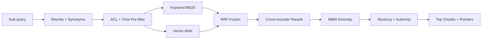

| Stage | Design | Why |
|---|---|---|
| Rewrite | Synonym expansion from the entity store and a topic thesaurus ("recsys", "for you", "next-best-action") | Internal language varies by team |
| **ACL + time pre-filter** | Inside the index query: `acl_principals ∩ user_principals ≠ ∅` and `effective_date in window` **[built]** | Filtering after ranking can starve results and can leak through summaries |
| Keyword | BM25 over chunk text + title + heading path | Code names and acronyms |
| Vector | ANN (HNSW) over chunk embeddings | Paraphrases |
| Fusion | Reciprocal rank fusion (k = 60) **[built]** | No score calibration needed between the two |
| Rerank | Cross-encoder on the top 100 → top 20 | Precision; capped for latency |
| Diversity | MMR across documents | Avoids 10 chunks from one deck |
| Boost | Recency inside window, authority (status report > meeting note), penalty for superseded | Prefers the current, official word |
| Output | Chunks with full source pointer | Every result can be cited |

#### 2.5.1 Relevance and sufficiency: what "relevant" means and when to stop

Retrieving *relevant* information is decided at four gates, each cheaper than the next.

| Gate | Test | Effect |
|---|---|---|
| 1. Hard filters | ACL, effective-date window, doc type, not superseded **[built]** | Out-of-scope content never reaches ranking |
| 2. Rank threshold | Rerank score below a calibrated cutoff (tuned on the golden set) | Dropped; if nothing passes, return `empty` with a hint |
| 3. Entity match | Passage mentions a target entity or alias, or a topic synonym | Keeps passages about the topic, not just near-miss keywords (golden "near-miss" items **[built]**) |
| 4. Question-aware extraction | Extractor is told the user's question and skips passages that do not answer it **[built]** | Irrelevant passages yield no claims, so they cannot be cited |

**Sufficiency (when to stop retrieving)** is defined per intent in 2.3.6. Generic rules: stop when coverage targets are met; stop when two successive replans add no new entities or claims (diminishing returns); stop on any budget. Whatever triggered the stop is recorded and shown in the report's scope line.

**Enumeration needs more than top-k.** For "all X" questions the planner also calls `list_documents` (a metadata scan by entity and window) and `entity_lookup`. Recall comes from the entity store and metadata, precision from search. The report states the searched scope ("searched 6 sources, 62 documents, window ...").

**Permission-aware retrieval in full:**
1. Identity resolver expands the user into principals (cached 5 min; the cache is invalidated on group-change events).
2. Every search, scan and fetch carries the principals; the index applies them as a pre-filter.
3. Entity lookup is also filtered: an initiative whose documents are all hidden is invisible, so its name cannot leak **[built]**.
4. Before delivery the verifier re-checks each cited document against a live source call or a fresh ACL entry.
5. Deny by default when the ACL is missing or older than its SLA **[built]**.
6. Each run logs the doc IDs retrieved and cited for that user.

### 2.6 Behaviour B2 (part 3): tool contracts and failure handling

All tools are read-only, typed and bounded.

| Tool | Args (validated) | Returns (bounded) | Typical use |
|---|---|---|---|
| `hybrid_search` | `query` ≤ 256 chars; `doc_type[]`; `effective_from/to`; `entity_ids[]`; `top_k` 1–50 | Chunks: id, doc id, title, snippet ≤ 1,200 chars, date, score, url | Main retrieval |
| `list_documents` | `entity_ids[]`, window, `doc_type[]`, `limit` ≤ 200 | Metadata only, no text | Recall for enumeration |
| `fetch_document` | `doc_id`, `sections[]` | Sections ≤ 8k tokens total | Read key docs fully |
| `entity_lookup` | `name` or `alias` or `topic` | Entities the user can see, aliases, owner team | Resolve and seed |
| `org_directory` | `team` | Team, owner, channel | "Who do I ask?" |

```json
{ "name": "hybrid_search",
  "args": { "query": "string(<=256)",
            "filters": { "doc_type": ["roadmap","prd","report","meeting","wiki"],
                         "effective_date_from": "date", "effective_date_to": "date",
                         "entity_ids": ["string"] },
            "top_k": "int(1..50)" },
  "returns": [{ "chunk_id": "str", "doc_id": "str", "title": "str", "snippet": "str(<=1200)",
                "effective_date": "date", "score": "float", "url": "str" }],
  "errors": { "status": "error|empty|partial", "hint": "str" } }
```

- **Before the call:** validate args against the schema; reject and return an observation, never an exception.
- **During:** timeout 2–5 s per tool; 2 retries with jittered backoff for transient errors; circuit breaker per connector.
- **After:** validate output schema; truncate to the bound; strip instruction-like sentences from text and mark the content as untrusted **[built]**.
- **Errors are observations:** `{"status": "empty", "hint": "no results in window; try widening or alias X"}` lets the planner widen, switch tools or record a gap.
- **Least privilege:** tools use a service identity that can only read, and always act on behalf of the user's principals.

### 2.7 Behaviour B3: synthesize findings

#### 2.7.1 Map-reduce synthesis

| Step | Done by | Input | Output |
|---|---|---|---|
| Map: extract | Small model per passage, question-aware **[built]** | One passage + the question | Records: entity, claim, date, status phrase, **reason** (why it started, paused or stopped), numbers, passage id |
| Validate | Code | Records | Schema-valid records; invalid → retry once → rules fallback **[built]** |
| Resolve entities | Entity store + rules (owner team, dates, context) | Records | Records grouped by canonical initiative; low-confidence merges flagged |
| Derive status | **Rules, not the model** **[built]** | Dated status phrases per initiative | `active`, `shipped`, `paused`, `cancelled`, `unknown`, with the deciding passage |
| Timeline | Code | Dated records | Ordered events with citations |
| Detect conflicts | Rules: two sources disagree on status or date within 45 days **[built]** | Records | Conflict entries citing both sides |
| Gaps | Code from coverage check | Plan vs evidence | "No status report found for X after 2025-06" |
| Reduce: write | Large model | Verified records only | Summary and per-initiative text that may only use record content |

- **Why rule-derived status:** status drives decisions ("is this still running?"). Rules are auditable and repeatable; a model can be swayed by a stale document. The prototype found a real bug here: a status was credited to a second initiative named in the same sentence. The fix attributes status only to the sentence's subject **[built]**.
- **Hierarchical reduce** when evidence exceeds the context: reduce per initiative, then across initiatives.
- **Source weighting:** status report and PRD > roadmap deck > meeting note. Meeting-only claims are written with hedged language ("discussed", "proposed").

#### 2.7.2 Memory

| | Short-term (working) | Long-term (persistent) |
|---|---|---|
| Holds | Plan, evidence ledger (`passage id → extracted records`), tool observations, scratchpad | User preferences (default sources, report format), saved reports, follow-up context for 24 h |
| Lifetime | One run (or one session for follow-ups) | TTL 180 days; user can view and delete |
| Size control | Token budget; raw passages replaced by extracted records after map; oldest observations summarized | Small, structured |
| Used as evidence? | Yes, only through cited passages | **Never.** Saved reports are re-validated against current ACLs and documents when reopened |
| Risks | Context overflow | Stale facts, poisoning, privacy |
| Controls | Compaction, trimming by rerank score | Opt-in consent, PII scrubbing, ACL re-check, delete propagation in 24 h |

### 2.8 Behaviour B4: structured response with references

#### 2.8.1 Response contract

```json
{ "run_id": "r_51c", "question": "string", "mode": "deep",
  "time_window": {"from": "2024-11-12", "to": "2026-11-12", "basis": "rolling 24 months"},
  "summary": "string (only facts present in findings)",
  "findings": [{ "initiative": "string", "aliases": ["string"], "owner_team": "string",
                 "period": "string", "status": "active|shipped|paused|cancelled|unknown",
                 "status_basis": "c4",
                 "reason": {"text": "string", "citations": ["c9"]},
                 "claims": [{ "text": "string", "citations": ["c1","c4"], "support": "supported|partial" }] }],
  "timeline": [{ "date": "date", "event": "string", "citations": ["c2"] }],
  "conflicts": [{ "description": "string", "citations": ["c3","c7"] }],
  "gaps": ["string"],
  "scope": {"sources_searched": 6, "documents_read": 62, "set_aside_unmatched": 3},
  "security_notes": ["string"],
  "degraded": ["string"],
  "citations": [{ "id": "c1", "doc_title": "string", "url": "string", "section": "string",
                  "effective_date": "date", "quote": "string(<=300)" }] }
```

The UI renders summary → findings cards → timeline → conflicts → gaps → sources, with each citation opening the source at the cited section. `degraded` and `security_notes` are shown, not hidden **[built]**.

#### 2.8.2 Verifier

| Check | Method | On failure |
|---|---|---|
| Schema | Pydantic / JSON schema | Retry once, then rules-based report **[built]** |
| Citation resolves | Citation ID exists, passage exists, offsets valid | Drop claim **[built]** |
| Grounding | Claim vs cited passage: lexical overlap + entailment model (NLI) in production; overlap heuristic in prototype **[built]** | `partial` → keep and mark; unsupported → drop |
| Numbers and dates | Every number or date in a claim must appear in its passage **[built]** | Drop claim; for the summary, fall back to the template summary **[built: happened once on P02]** |
| Summary consistency | Summary may only mention entities and numbers present in verified findings | Replace with template summary |
| Live ACL re-check | Fresh access check per cited doc **[built]** | Remove doc, its claims, and any finding left without support |
| Drop ratio | If > 30% of claims dropped | Re-synthesize once with stricter prompt, else deliver with a warning |

**"Not found" is a first-class answer.** If no accessible passage supports anything, the response says so and lists what was searched **[built]**. It does not reveal whether hidden documents exist.

### 2.9 The running example traced end to end

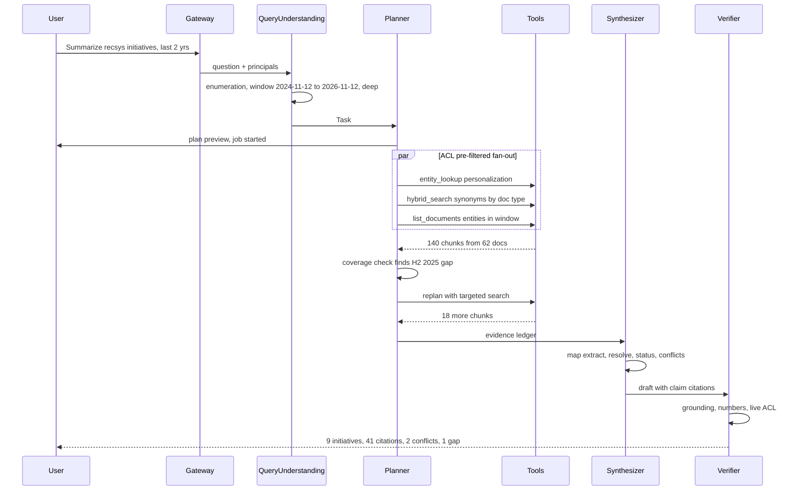

| Phase | What happens | Guards in force |
|---|---|---|
| Understand | Intent = enumeration; window resolved in code; mode = deep; seed entities from aliases | Input guardrails; no date math by the model |
| Plan | Synonyms × doc types; coverage targets per entity and per quarter; plan previewed | Plan schema; rules fallback; budget allocated |
| Act | Entity lookup, hybrid search and metadata scan in parallel | ACL + time pre-filter on every call; timeouts; schema checks |
| Observe | Coverage grid shows no status reports for H2 2025 | Per-passage coverage; goal re-statement |
| Replan | Targeted search of meeting notes and status reports for that half-year | Replan cap 3; max 6 fetches per replan; repeat-call suppression |
| Synthesize | Extract per passage; merge "Project Compass" with "RecSys v2"; rules derive status; 2 conflicts found | Schema retry and fallback; source weighting |
| Verify | Ground each claim; check numbers; live ACL re-check of 41 cited docs | Drops unsupported claims; template summary fallback |
| Deliver | Report with 9 initiatives, timeline, 2 conflicts, 1 gap, scope line | Audit record written; feedback widget shown |

**Same question as the contractor (J4):** pre-filter leaves 0–2 permitted documents; entity lookup hides initiatives with no visible documents; the answer is a smaller report or "no accessible sources", with no hint of hidden work **[built: permission tests pass]**.

### 2.10 Deployment topology (production)

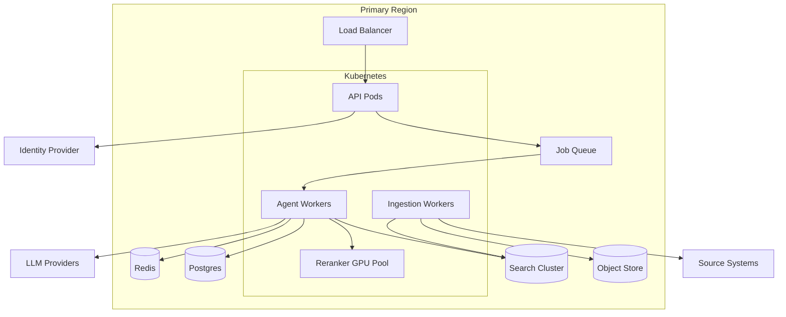

- **Stateless API and agent workers** scale on queue depth and CPU; deep runs survive a worker restart because the run state checkpoints to Postgres after each step.
- **Search cluster** (managed OpenSearch/Elasticsearch or a vector DB with keyword support) holds both indexes and applies the ACL filter.
- **Postgres** holds entities, runs, steps, claims, citations, audit and feedback. **Redis** holds sessions, ACL principal cache, semantic cache and rate-limit counters.
- **Region-pinned:** all stores and LLM endpoints in the same region for residency.

### 2.11 Data flow and data model

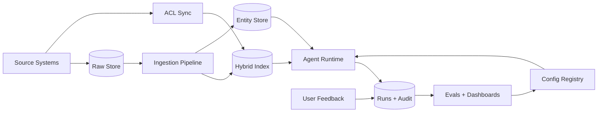

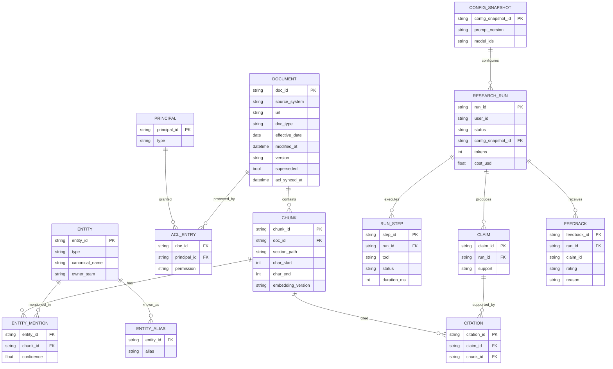

**Integrity rules:** every citation must reference an existing chunk and claim (FK, validated on write) **[built]**; a claim with zero citations cannot be persisted; every run references the config snapshot that produced it **[built]**.

### 2.12 External interfaces

| Endpoint | Purpose | Notes |
|---|---|---|
| `POST /research` | Start a run; returns `run_id`; quick mode streams via SSE | Idempotency key; mode hint optional |
| `GET /research/{run_id}/events` | Progress events: plan, step done, partial findings, done | SSE; resumable |
| `GET /research/{run_id}` | Final report (schema in 2.8.1) | ACL re-checked on every read |
| `POST /research/{run_id}/cancel` | Cancel a deep run | Partial report kept |
| `POST /feedback` | Run-level or claim-level feedback | Goes to audit and triage |
| `GET /diagnostics` | Health, recent runs, budgets, error rates | Admin role only |

In the prototype these are Python functions in `app/services/` called by Streamlit **[built]**; the HTTP layer is the production addition.

---

## 3. Trade-off Analysis

### 3.1 Method

For each decision: the options considered, the choice, what it gave up, why it is right **for this problem**, and the **signal that would make us revisit it**. A trade-off without a revisit trigger is a habit, not a decision.

### 3.2 Trade-offs ledger, by framework step

| # | Step | Tension | We lean | We gave up | Why it's right here | Revisit when |
|---|---|---|---|---|---|---|
| T1 | B1 planning | Upfront plan vs purely reactive (ReAct) | Plan first, bounded replanning | Flexibility on odd queries | Previewable, budgetable, auditable; replanning still closes gaps | > 15% of runs hit the replan cap |
| T2 | B1 orchestration | Single vs multi-agent | Single planner + deterministic parallel workers | Specialist reasoning per source | Fewer handoffs and cascading errors; simple traces; lower cost | New tool families need different reasoning (SQL, code) |
| T3 | B1 planning | Model plans vs code plans | Code owns skeleton and dates; model proposes queries | Some cleverness on unusual phrasing | Dates and coverage must be exact; model failure must not stop the run | Model plan beats rules on recall by > 10 points in evals |
| T4 | B2 retrieval | Vector-only vs hybrid | Hybrid BM25 + vector + RRF + rerank | Simplicity; about 100 ms | Code names break embeddings; paraphrases break keywords | Never, for this corpus type |
| T5 | B2 recall | Top-k only vs metadata scan + entity index | Add entity store and metadata scan for enumeration | Entity maintenance cost | "All X" needs recall beyond top-k | Entity extraction precision < 80% |
| T6 | B2 permissions | Pre-filter vs post-filter | Pre-filter in index + live re-check before delivery | ACL sync infrastructure; index complexity | Post-filter leaks through LLM summaries; leak rate must be 0 | Never relax; tighten if sync lag grows |
| T7 | B2 freshness | Index vs live query of sources | Event-driven index (15 min) + live fetch to verify cited docs | Real-time content | Six live APIs are slow and rate-limited | A source with near-real-time needs (incident tickets) |
| T8 | B2 dating | Modified date vs effective date | Effective date extracted at ingestion | Extraction cost and errors | Edited old roadmaps are not new initiatives (the time-window trap) | Never; tune extractor |
| T9 | B3 synthesis | Stuff context vs map-reduce | Map-reduce with records | Latency; more calls | Context overflow and lost citations otherwise | Context windows and cost make stuffing cheaper and evals agree |
| T10 | B3 status | Model-judged vs rule-derived status | Rules with the deciding passage cited | Coverage of unusual phrasing | Auditable, repeatable; status drives decisions | Rules miss > 10% of statuses in pilot → trained classifier + human review |
| T11 | B4 grounding | Strict citation vs fluency | Strict: drop or flag unsupported claims | Smoothness and inferred insight | A wrong uncited claim costs more trust than a terse answer | Users rate answers too terse and faithfulness has headroom |
| T12 | B4 verification | Self-check by same model vs independent verifier | Code checks + separate NLI model | Extra latency (about 1–2 s) | Same-model self-check shares the same blind spots | Never remove; swap model as better ones arrive |
| T13 | Cost | One big model vs routing + caching | Small model for classify/extract/verify; large for plan/summary | Some peak extraction quality | Extraction is about 70% of tokens; routing cuts cost 3–4× | Small-model extraction F1 drops below threshold |
| T14 | Interaction | Sync chat vs async jobs | Both: quick streams; deep runs async | One simple path | Matches the job | Most deep runs finish < 20 s |
| T15 | Hosting | Cloud LLM vs local models | Provider-agnostic gateway; prototype local only **[built]** | Peak quality of frontier models in prototype | Data never leaves the machine; zero-retention contracts in prod | Contract and residency allow a cloud model with better evals |
| T16 | Memory | Rich long-term memory vs minimal | Opt-in preferences and saved reports, never evidence | Personalization depth | Avoids stale and poisoned facts; easier privacy review | Clear user demand with a safe design |
| T17 | Build vs buy | Build retrieval vs managed search | Managed search + own agent layer | Fine control of index internals | Faster time to value; the agent and trust logic is the differentiator | Index cost or feature limits |
| T18 | Abstention | Answer best-effort vs abstain | Abstain with scope stated | Some "helpful" answers | Silence is safer than invention for decision support | Abstain rate on answerable questions > 10% |

### 3.3 Decision deep dives

**D1. Planning style (T1, T3).**

| Option | Strength | Weakness |
|---|---|---|
| Pure ReAct (think → act each step) | Adapts to surprises | Unpredictable cost; hard to preview; prone to loops |
| Fixed pipeline (no planning) | Cheap, predictable | Cannot enumerate or fill gaps |
| **Plan-then-execute with bounded replanning** | Previewable, budgetable, still adaptive | Upfront plan can be wrong; mitigated by replans |
| Tree search over plans | Best coverage | Cost explodes; slow |

Choice: plan-then-execute, model proposes queries, code owns dates and coverage. Business why: the PM sees and can correct the plan before spending minutes, and finance sees a bounded cost per run.

**D2. Permission enforcement point (T6).**

| Option | Leak risk | Recall | Cost |
|---|---|---|---|
| Post-filter after retrieval | High: content reaches the LLM before filtering | Starves (top-k fills with hidden docs) | Low |
| Per-user index | Very low | Good | Huge (20k indexes) |
| **Pre-filter in shared index + live re-check** | Very low | Good | Moderate (ACL sync) |
| Query-time call to each source | Lowest | Good | Too slow and rate-limited |

Choice: pre-filter plus live re-check of cited docs only. Business why: zero leaks is the precondition for security sign-off; checking only the 20–50 cited docs live keeps it cheap.

**D3. Synthesis structure (T9, T10).** Stuffing 140 chunks into one prompt loses citations and overflows context; per-passage extraction into records makes every fact traceable, lets code do dedupe, status and conflicts, and leaves the model only the writing. The prototype confirmed the value: two of three real-model defects were found in exactly these steps and fixed with rules.

**D4. Model routing (T13).** Classify, extract and verify are narrow tasks that small models do well; planning and final writing benefit from a large model. Prototype: `llama3:8b` for planning and extraction, `gpt-oss:20b` for the summary **[built]**. Production keeps the same split behind the gateway so models can be swapped by config and gated by evals.

### 3.4 Prototype vs production deltas

| Concern | Prototype (built, measured) | Production design | Why the difference |
|---|---|---|---|
| Corpus | 52 synthetic docs, 15 initiatives | 5M docs from 6 connectors | Scale |
| Store | SQLite + in-process index | Search cluster + Postgres + Redis | Scale and concurrency |
| Entities | Hand-seeded aliases | Extraction pipeline + human review queue | Cannot hand-seed 5M docs |
| Rerank | RRF only | RRF + cross-encoder + MMR | Precision at scale |
| Grounding | Lexical overlap + number check | + NLI entailment model | Paraphrased claims |
| ACL | Group ACL table, live re-check | Synced from sources, event-driven | Real permissions |
| Invocation | Synchronous Streamlit call | Quick (SSE) + deep (async jobs) | Minutes-long reports |
| Observability | JSON logs, diagnostics page | OpenTelemetry traces, metrics, online evals | Multi-service debugging |
| Eval | 30-item golden set, offline | 300+ items, CI gate, online judges | Release safety |
| Auth | Demo user picker | SSO | Real identity |

---

## 4. Failure Mode Analysis

### 4.1 Method

FMEA-style: for each failure, the **stage**, **effect**, **severity (S)**, **likelihood (L)** and **detectability (D)** on 1–5 (5 = worst; for D, 5 = hardest to detect), a **risk priority** = S × L × D, how it is **detected**, how it is **mitigated**, and whether it **fails open or closed**. Scores are illustrative judgments to rank effort, not measurements.

### 4.2 Failure modes by pipeline stage

| # | Stage | Failure | Effect | S | L | D | RPN | Detection | Mitigation |
|---|---|---|---|---|---|---|---|---|---|
| F7 | Retrieval | Permission leak (stale or missing ACL, cache bug) | Security incident | 5 | 2 | 4 | 40 | Leak canaries in CI and prod; audit diff of cited vs allowed | Pre-filter; deny by default; live re-check; entity lookup filtered; kill switch per source **[built: pre-filter, deny default, re-check]** |
| F5 | Synthesis/verify | Confident hallucination | Wrong decision | 5 | 3 | 3 | 45 | Verifier grounding score; online judge; claim feedback | Claim → passage check; number check; drop or flag; abstain **[built]** |
| F10 | Retrieval | Low recall on enumeration | Missing initiatives; incomplete report looks complete | 4 | 3 | 4 | 48 | Enumeration recall on golden set; "missing" feedback | Synonyms; entity store; metadata scan; coverage grid; scope line in report |
| F8 | Ingestion/retrieval | Prompt injection in a document | Wrong answer or exfiltration attempt | 4 | 2 | 3 | 24 | Injection classifier; security notes count | Untrusted delimiting; instruction sentences stripped; read-only tools; no outbound calls **[built]** |
| F12 | Ingestion | Time misattribution (edit date used) | Old work reported as new | 3 | 3 | 3 | 27 | Time-trap golden items | Effective date; filter on effective date **[built]** |
| F11 | Synthesis | Entity confusion (two "Atlas" projects) | Merged or split findings | 3 | 3 | 3 | 27 | Duplicate-entity rate; feedback | Owner + date + context resolution; low-confidence merges flagged |
| F9 | Ingestion | Stale or superseded content wins | Wrong status | 3 | 4 | 3 | 36 | Conflict rate; "outdated" feedback | Superseded flag; latest version; authority weighting; conflicts shown **[built]** |
| F1 | Agent loop | Infinite or long loop | Latency and cost spike | 3 | 3 | 1 | 9 | Step counter; repeated-call hash | Caps; repeat suppression; partial answer **[built]** |
| F2 | Agent loop | Plan derailment | Off-topic report | 3 | 2 | 3 | 18 | Relevance score per step; judge | Goal re-statement; pruning; replan cap |
| F3 | Synthesis | Context overflow | Lost evidence or citations | 3 | 3 | 2 | 18 | Token monitor | Map-reduce; rerank and trim; hierarchical reduce |
| F4 | Tools | Cascading errors (bad output poisons later steps) | Corrupt report | 4 | 2 | 2 | 16 | Schema validation failures | Validate in and out; retry; fallback; fail closed on ACL **[built]** |
| F6 | Platform | Cost runaway | Budget overrun | 2 | 3 | 1 | 6 | Per-run cost meter; spend alerts | Token and $ caps; routing; caching; deep only on intent **[built: token cap]** |
| F13 | Ingestion | Noisy transcripts overstate claims | Overconfident report | 2 | 4 | 3 | 24 | Claim feedback by source type | Source weighting; hedged wording |
| F14 | Connectors | Source outage or API change | Partial coverage | 3 | 4 | 2 | 24 | Connector health; ingestion lag | Circuit breakers; reconciliation; report says which source was unavailable |
| F15 | Platform | LLM outage or rate limit | Downtime | 4 | 3 | 1 | 12 | Error rate; 429s | Gateway failover; queue deep jobs; degrade to cited search |
| F16 | Ingestion | Embedding model change mixes vectors | Silent recall drop | 3 | 2 | 4 | 24 | Retrieval evals; embedding version check | Versioned index; blue/green reindex |
| F17 | Delivery | Dangling or wrong citation | Trust loss | 4 | 2 | 2 | 16 | Citation validity check | Verifier resolves every citation; FK integrity **[built]** |
| F18 | Platform | PII exposure in output or logs | Compliance breach | 4 | 2 | 3 | 24 | Output PII scan; log scanning | Masking in logs and traces **[built]**; restricted collections opt-in |
| F19 | Memory | Long-term memory poisoning or stale saved report | Wrong facts reused | 3 | 2 | 4 | 24 | Saved-report revalidation diffs | Memory never used as evidence; ACL and doc re-check on reopen |
| F20 | Query understanding | Wrong time window or intent | Correct-looking answer to the wrong question | 4 | 2 | 4 | 32 | Window shown in report; golden edge items | Code-based date resolver **[built]**; clarifying question; window echoed in answer |

**Highest priorities (RPN ≥ 30):** F10 low recall, F5 hallucination, F7 permission leak (top by severity regardless of RPN), F9 stale content, F20 wrong window. These get the most eval coverage and the strictest alerts.

### 4.3 The six agentic failure modes (summary view)

| Failure mode | Symptom | Mitigation | Prototype evidence |
|---|---|---|---|
| Infinite or long loops | Repeated near-identical searches | Step, replan, time caps; repeat-call suppression; partial answer | 12 steps, 3 replans, 3 min, 60 tool calls; repeats suppressed |
| Plan derailment | Drifts to general "ML infra" | Goal re-statement; relevance pruning; replan cap | Coverage check tied to the original entities |
| Context overflow | Truncated evidence | Map-reduce; trimming; hierarchical reduce | Per-passage extraction |
| Cascading errors | Bad tool output poisons synthesis | Schema validation; retry once; rules fallback; fail closed | Schema retry then fallback |
| Confident hallucination | Fluent uncited claims | Grounding and number checks; abstain | Template summary used once (P02) when the number check failed |
| Cost runaway | $/run spikes | Token and $ caps; routing; caching | 60k token cap; 82,840 tokens for 30 questions |

### 4.4 Fail-open vs fail-closed policy

| Component fails | Policy | Behaviour |
|---|---|---|
| ACL data missing or stale | **Closed** | Document invisible |
| Live ACL re-check unavailable | **Closed** | Uncheckable citations removed; answer notes it |
| Input guardrail classifier down | **Closed** for injection heuristics (rules still run); open for PII classifier with rules fallback | Request continues only if rules pass |
| Reranker down | Open | Use RRF order; mark `degraded` |
| Planner model fails | Open | Rules-based plan **[built]** |
| Extraction model fails | Open | Rules-based extraction, fewer claims **[built]** |
| Summary model fails or fails checks | Open | Template summary **[built]** |
| Verifier NLI model down | **Closed** for numbers and citations (code checks still run); claims marked `partial` | Never ship unverified claims as supported |
| One connector down | Open | Answer from other sources; scope line names the missing source |
| All LLMs down | Open (degraded) | Cited search results only, no synthesis |

### 4.5 Graceful degradation ladder

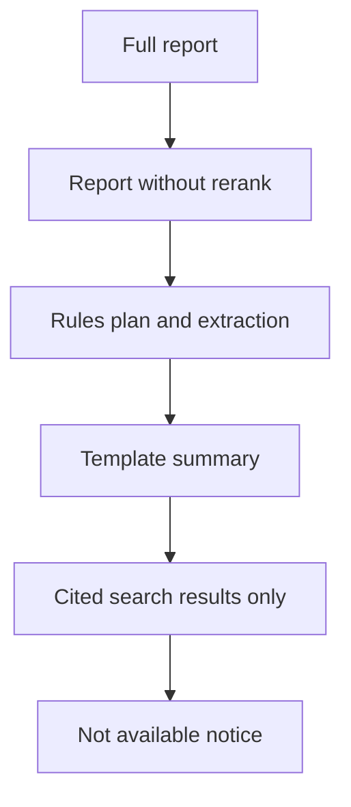

Each step down is recorded in `degraded` on the run and shown in the UI. The system never drops below the trust floor: citations and permissions hold at every level.

### 4.6 Human-in-the-loop points

| Point | Who | Why |
|---|---|---|
| Plan preview for deep runs | Asker | Correct scope before spending minutes and money |
| Clarifying question | Asker | Avoid answering the wrong question |
| Claim-level feedback | Asker | Fast correction signal **[built]** |
| Low-confidence entity merges | Knowledge manager | Prevent wrong merges entering the entity store |
| Sharing a saved report | Asker | Re-checks recipients' access first |
| Any future write tool | Asker + approver | Never autonomous (Never list 4) |

---

## 5. Observability & Feedback Loops

### 5.1 Tracing model

One trace per run; spans mirror the agent loop so a reviewer can replay the reasoning.

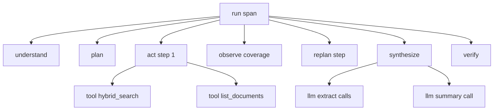

| Span attribute | Example | Notes |
|---|---|---|
| `run_id`, `request_id`, `user_id` (hashed) | `r_51c` | Correlates UI, workers, audit **[built: request IDs]** |
| `config_snapshot_id`, `prompt_version`, `model` | `cfg_0412`, `extract_v7`, `llama3:8b` | Reproducibility **[built]** |
| Tool args and result summary | `top_k=20`, `results=17`, doc IDs, scores | Full payloads stored by reference, PII-redacted |
| Tokens in/out, cost, latency, status | `1,240 / 310`, `$0.002`, `820 ms`, `ok` | **[built: tokens, durations, status]** |
| Budget state | `steps=5/12`, `replans=1/3` | Explains partial answers |
| Coverage grid | entities covered 8/9 | Explains replans |
| Verifier outcome | claims kept 41, dropped 3, reasons | Quality signal per run |

### 5.2 Metrics by level

| Level | Metrics | Primary consumer |
|---|---|---|
| Request | p50/p95 TTFT and total latency; success, error, partial and abstain rates; tokens and $/run | On-call |
| Agent step | Steps and replans per run; budget-hit rate; repeat-call suppressions; tool error and timeout rates per tool; fallback rate per stage | Agent engineers |
| Retrieval | Empty-result rate; recall@k on probe set; rerank latency; ACL-filtered share; cache hit rate | Search engineers |
| Quality | Faithfulness; citation validity; claim drop rate; uncited-claim count (must be 0); judge score on sampled traffic | Quality owner |
| Security | Leak canary hits (must be 0); injection detections; access-denied counts | Security |
| Data | Ingestion lag per connector; ACL sync lag; parse failure rate; % docs with effective date; index size and drift | Data platform |
| Business | WAU; queries per user; useful-rating share; exports; estimated time saved; top unanswered topics | Product, leadership |

### 5.3 Dashboards

1. **Operations:** latency, errors, saturation, queue depth, LLM 429s, cost burn vs forecast.
2. **Agent behaviour:** steps and replans distributions, budget hits, fallbacks and degradation levels.
3. **Quality and trust:** faithfulness, citation validity, drops, abstains, leak canaries, feedback.
4. **Data health:** ingestion and ACL lag per connector, parse failures, coverage by source.
5. **Business:** adoption, satisfaction, time saved, top topics and gaps. (Prototype: Analytics and Diagnostics pages **[built]**.)

### 5.4 Evaluation

**Offline (gates every release):**

| Set | Size (prod target) | Contents | Prototype |
|---|---|---|---|
| Positive | 120 | Single-hop, multi-hop, enumeration with known complete lists, timelines | 10 |
| Negative | 50 | Answer does not exist → must abstain | 6 |
| Edge | 80 | Time-window traps, aliases, conflicts, superseded drafts, injection-laced docs, over-long input, keyword near-misses | 10 |
| Permission | 50 | User A must not see doc X; contractor asks the running example | 4 |
| **Total** | **300** | Grows weekly from feedback | **30 → 30/30, 0 leaks [built]** |

**Global invariants checked on every answer:** no uncited claim; no dangling citation; no document outside the asker's allow-list retrieved or cited **[built]**.

**Metrics:** answer correctness; faithfulness; citation validity; enumeration recall and precision; status accuracy; abstain correctness; ACL-leak rate; tool-call success; latency and cost.

**LLM-as-judge and its biases:**

| Bias | Effect | Countermeasure |
|---|---|---|
| Position | Prefers the first answer in pairwise comparisons | Randomize order; score both orders |
| Verbosity | Prefers longer answers | Length-normalized rubric; penalize unsupported text |
| Self-preference | Favors its own model family | Judge from a different family |
| Leniency drift | Scores creep up over time | Re-calibrate monthly on 100 human-labelled items; target κ ≥ 0.7 |

**Honest reading of prototype results:** the golden set was also used to find and fix bugs, so 30/30 is not evidence of accuracy on unseen questions. A held-out set (never used for debugging) is the first evaluation task for v1.

**Online (production):** judges on about 5% of traffic; leak canary probes every 15 minutes with synthetic users and planted documents; drift detection on query topics, retrieval empty rate and abstain rate; A/B tests for prompt and model changes.

**Offline vs online catch different things:** offline catches regressions before release; online catches drift, new question types, source changes and real user failures.

### 5.5 Feedback loops

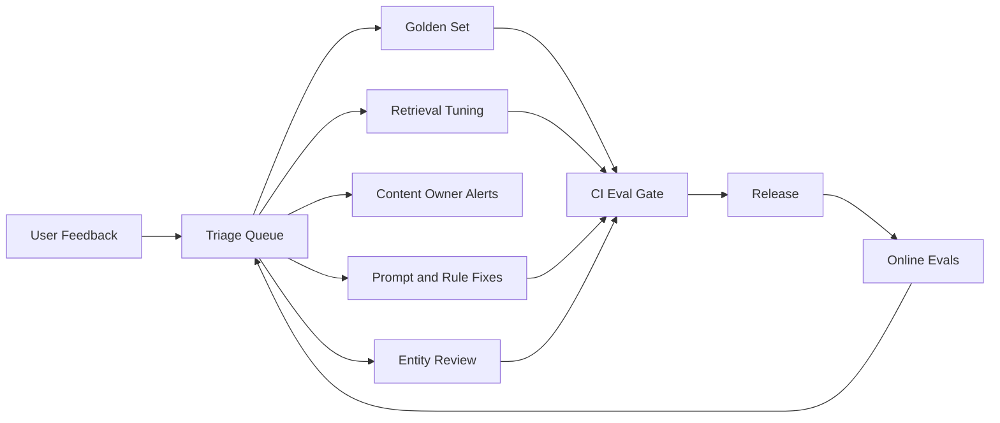

| Loop | Signal | Action | Cadence | Owner |
|---|---|---|---|---|
| Quality | Claim flagged wrong or unsupported | Becomes a golden item and a reranker hard negative; prompt or rule fix | Weekly triage | Quality owner |
| Content | Repeated "outdated" flags on a document | Notify doc owner; down-rank until fixed | Daily | Knowledge management |
| Coverage | Clusters of "not found" or "missing initiative" | New connector, alias or synonym; entity review | Bi-weekly | Product |
| Entity | Low-confidence merges; split-entity feedback | Human review updates aliases | Weekly | Knowledge management |
| Retrieval | Clicks on cited sources; ignored citations | Tune boosts and rerank thresholds | Monthly | Search engineers |
| Cost | $/run by intent and mode | Adjust routing, caps and cache TTLs | Monthly | FinOps |
| Security | Canary hits; injection detections | Incident process; new red-team cases | Immediate | Security |

### 5.6 Release gates

A change to prompts, models, retrieval config, rules or thresholds ships only if: offline golden pass rate does not drop; ACL-leak rate = 0; citation validity ≥ 98%; faithfulness does not drop > 1 point; p95 latency and $/run within 10% of baseline. Then shadow → 5% A/B → full rollout.

---

## 6. Productionization & Operations

### 6.1 Environments and release path

| Environment | Data | Purpose |
|---|---|---|
| Local / dev | Synthetic corpus (as in this repo) | Feature work; mock provider for fast tests **[built]** |
| CI | Synthetic corpus + golden set | Unit tests, schema tests, offline evals, red-team suite |
| Staging | Mirror of 1–2 real sources with real ACLs | Integration, load, permission tests |
| Production | All sources | Users |

### 6.2 Invocation patterns

- **Quick mode:** synchronous; SSE streaming; first token from the summary only after verification of findings, so streaming never shows unverified claims (findings stream as verified cards).
- **Deep mode:** async job; plan preview → progress events (plan, sources searched, initiatives found so far) → notification when done; cancel keeps a partial report.
- **Follow-ups:** reuse the session's evidence ledger; re-retrieve only for new scope.
- **Channels:** web app first; Slack or Teams bot posts a summary with a link to the full report (v1).
- **Clarifying questions:** at most one per run, before planning.

### 6.3 Scaling: where it breaks first

| Order | Bottleneck | Symptom | Response |
|---|---|---|---|
| 1 | LLM rate limits during deep-run peaks | 429s, queue growth | Gateway quotas, priority (quick > deep), multi-provider, extraction batching, cache extraction per chunk version |
| 2 | Reranker latency | p95 creep | GPU pool, cap candidates at 100, skip rerank in quick mode under load |
| 3 | ACL filter selectivity (users in thousands of groups) | Slow filtered queries | Principal bitmaps; group flattening; pre-computed doc-principal tokens |
| 4 | Context window on huge enumerations | Overflow, truncation | Hierarchical reduce; per-initiative synthesis |
| 5 | Connector API limits | Ingestion lag | Backoff; reconciliation windows; negotiated quotas |

### 6.4 SLOs, SLIs and error budgets

| SLO | SLI | Target | Error budget (30 days) |
|---|---|---|---|
| Answer availability | Successful or gracefully degraded runs / all runs | 99.5% | About 3.6 hours |
| Quick latency | p95 total | < 20 s | 5% of requests over |
| Deep latency | p95 completion | < 4 min | 5% over |
| Permission safety | Leak canary hits | **0** | **None.** Any hit is an incident |
| Faithfulness | Online judge sample | ≥ 95% | 24-hour rolling drop > 3 points pages |
| Freshness | Ingestion lag; ACL lag | < 15 min; < 5 min | Per-connector alert |
| Cost | Daily spend vs forecast | ≤ 110% | > 120% alerts FinOps |

When an error budget is spent, feature releases pause and the team works on reliability until it recovers.

### 6.5 Alerts and on-call runbooks

| Alert | Severity | First actions (runbook) |
|---|---|---|
| Leak canary hit | **SEV1, page immediately** | Kill switch for the affected source; freeze saved-report sharing; pull audit for affected runs; notify Security; root cause before re-enable |
| Error rate > 2% for 5 min | SEV2 | Check LLM gateway 429/5xx; fail over provider; check recent deploys; roll back config snapshot |
| p95 breach for 15 min | SEV3 | Check queue depth, reranker latency, LLM latency; shed deep load; skip rerank in quick mode |
| Faithfulness drop > 3 points | SEV2 | Identify config or model change in window; roll back prompt/model version; sample failing traces |
| Connector down or lag breach | SEV3 | Circuit breaker opens automatically; UI banner; check credentials and API changes; reconcile when back |
| ACL sync lag > 5 min | SEV2 | Deny-by-default already applies; investigate sync worker; scale or replay events |
| Cost > 120% forecast | SEV3 | Find top runs and users by cost; check for loops; tighten caps; check cache hit rate |
| Injection spike | SEV3 | Identify source documents; quarantine; notify owners; add red-team cases |

### 6.6 Change management: prompts and models are config

- Prompts, tool schemas, routing rules, thresholds and budgets live in a **versioned config registry** with PR review **[built: config.yaml + per-run snapshot id]**.
- Every change runs the offline eval gate (5.6) in CI.
- Model upgrades: offline eval → shadow traffic → 5% A/B → full rollout; old version kept warm for instant rollback.
- Index changes: blue/green reindex; retrieval evals compared before cutover; never mix embedding versions.
- Every run stores its `config_snapshot_id`, so any answer can be reproduced and explained.

### 6.7 Backup, disaster recovery and data lifecycle

| Asset | Backup | RPO / RTO | Notes |
|---|---|---|---|
| Postgres (runs, audit, entities) | PITR + daily snapshot, cross-zone | 15 min / 1 h | Audit is compliance evidence |
| Search index | Rebuildable from raw store; snapshots daily | 24 h / 4 h | Rebuild path tested quarterly |
| Raw store | Versioned object storage | 0 / 1 h | Source of truth for reparse |
| Redis | Not backed up | n/a | Cache and sessions only |

**Retention and deletion:** audit 1 year (configurable); traces 30 days full, 1 year summarized; long-term memory 180 days. A deletion in a source propagates to index, caches, saved reports and memory within 24 hours.

### 6.8 Cost model (illustrative)

| Item | Estimate |
|---|---|
| Quick answer (about 3 small-model calls + 1 large) | ≈ $0.05 |
| Deep report (about 40 small-model extractions + plan, summary, verify on large) | ≈ $0.60 |
| Blend: 85% quick, 15% deep, 6k queries/day | ≈ $0.13 × 6k ≈ $800/day ≈ $24k/month LLM |
| Infrastructure (search, GPUs, DBs, workers) | ≈ $8–12k/month |
| Value check | 6k queries × 15 min saved × $80/h ≈ $120k/day of recovered time |

**Cost levers, in order of impact:** model routing; extraction cached per chunk version (most chunks never change); ACL-scoped semantic cache for repeat questions; prompt caching; deep mode only on intent; per-run caps. **Prototype:** local models, $0 marginal cost; 82,840 tokens across 30 golden questions **[built]**.

### 6.9 Security and governance

- **Identity and access:** SSO; group expansion; least-privilege service identities; admin roles for diagnostics.
- **Data protection:** encryption at rest and in transit; region-pinned storage and LLM endpoints; zero-retention, no-training LLM terms.
- **Audit trail:** who asked, question, docs retrieved and cited, model, config snapshot, cost, decision, feedback, timestamp **[built]**.
- **Registers:** data-sources register (owner, classification, connector, ACL model; synthetic vs real) **[built: docs/data_sources.md]**; model and config registry.
- **PII:** masked in logs and traces (emails, phones, IDs, cards, API keys) **[built]**; output PII scan; restricted collections opt-in.
- **Red-teaming:** injection, exfiltration and permission-probing suites in CI; annual pen test.
- **Responsible use:** read-only; informs and never decides; feedback on every report; limitations shown in the UI.

### 6.10 Rollout plan and roadmap (trust features ship first)

| Phase | Scope | Exit criteria |
|---|---|---|
| **v0 pilot** (one team, about 6 weeks) | Read-only; wiki + docs; quick mode; ACL pre-filter and citations from day one; 100-item golden set; tracing | 0 leaks; citation validity ≥ 98%; ≥ 60% useful rating; time saved measured |
| **v1** (3–4 teams) | All 6 sources; deep async reports; entity extraction + review; NLI verifier; online evals; routing; semantic cache; Slack bot; held-out eval set | Enumeration recall ≥ 85% on held-out set; p95 targets met; cost ≤ forecast |
| **v2** (company-wide) | Saved and shared reports with ACL re-check; scheduled briefs; proactive conflict detection; human-approved write tools | SLOs held for 1 quarter; security review passed |

### 6.11 Team and ownership (RACI-lite)

| Area | Owner | Consulted |
|---|---|---|
| Agent runtime, planner, verifier | AI engineering | Product |
| Retrieval, index, reranker | Search engineering | AI engineering |
| Connectors, ingestion, ACL sync | Data platform | Security |
| Evals, golden set, judges | Quality owner | Product, domain experts |
| Security, red-team, incidents | Security | All |
| Cost and quotas | FinOps | AI engineering |
| Adoption, feedback triage | Product | Knowledge management |

### 6.12 Risk register

| ID | Risk | L | I | Mitigation | Owner |
|---|---|---|---|---|---|
| R1 | Permission leak | Low | Critical | Pre-filter, deny default, live re-check, canaries, kill switch | Security |
| R2 | Early hallucinations destroy trust | Medium | High | Strict grounding, visible citations, small v0, claim feedback | Product |
| R3 | 30/30 on a development set overstates accuracy | High | Medium | Held-out set before v1; online judges | Quality owner |
| R4 | Status rules don't generalize to real phrasing | High | Medium | Pilot measurement; classifier + human review if rules miss > 10% | AI engineering |
| R5 | Entity extraction quality at scale | Medium | High | Review queue; confidence thresholds; alias feedback loop | Knowledge management |
| R6 | Connector API limits and changes | High | Medium | Reconciliation, circuit breakers, contract tests | Data platform |
| R7 | LLM cost overrun | Medium | Medium | Caps, routing, caching, budgets | FinOps |
| R8 | Poor source quality (stale wikis) | High | Medium | Content-owner loop; freshness signals; conflicts shown | Knowledge management |
| R9 | Deep-run latency too long for users | Medium | Medium | Async + progress; caching; routing | AI engineering |
| R10 | Adoption stalls | Medium | High | Slack integration, champions, time-saved reporting | Product |

### 6.13 Assumptions and limitations

- Answers are only as good as the documents; the system reports gaps but cannot fill them.
- Effective-date, entity and status extraction are probabilistic or rule-bound; low-confidence cases are flagged.
- Prototype numbers come from 52 synthetic documents on one machine; production numbers are illustrative until a pilot.
- Sources without ACL or change APIs get nightly sync and stricter deny-by-default, so they are less fresh.
- The assistant informs decisions; it does not make them.

---

## Appendix A. Requirement → design → failure → metric traceability

| Requirement | Design element | Failure modes covered | Metric / gate |
|---|---|---|---|
| FR2 time resolution | 2.3.1 code date resolver | F12, F20 | Time-trap golden items |
| FR3–FR4 plan and replan | 2.3.2–2.3.4 plan schema, state machine, budgets | F1, F2, F6 | Steps, replans, budget-hit rate |
| FR6 permission-limited retrieval | 2.5 pre-filter, 2.8.2 live re-check | F7 | Leak rate = 0 (SEV1) |
| FR7 aliases | 2.4 entity store, 2.5 rewrite | F10, F11 | Alias golden items; enumeration recall |
| FR9–FR10 dedupe, status, conflicts | 2.7.1 map-reduce, rules | F9, F11, F13 | Duplicate-entity rate; status accuracy |
| FR11–FR12 structured, cited output | 2.8 contract and verifier | F5, F17 | Citation validity ≥ 98%; uncited = 0 |
| FR13 abstain | 2.8.2 not-found path | F5 | Negative golden items |
| FR14 feedback | 5.5 loops | All | Feedback volume; triage SLA |

## Appendix B. Glossary

- **ACL:** access control list; who may open a document.
- **Effective date:** the date a document's content is about, not when it was last edited.
- **RRF:** reciprocal rank fusion; merges keyword and vector rankings without score calibration.
- **MMR:** maximal marginal relevance; picks results that are relevant and different from each other.
- **NLI:** natural language inference; a model that checks whether a passage supports a claim.
- **Golden set:** questions with known correct outcomes used to test every release.
- **Canary:** a planted test document and user used to detect permission leaks in production.
